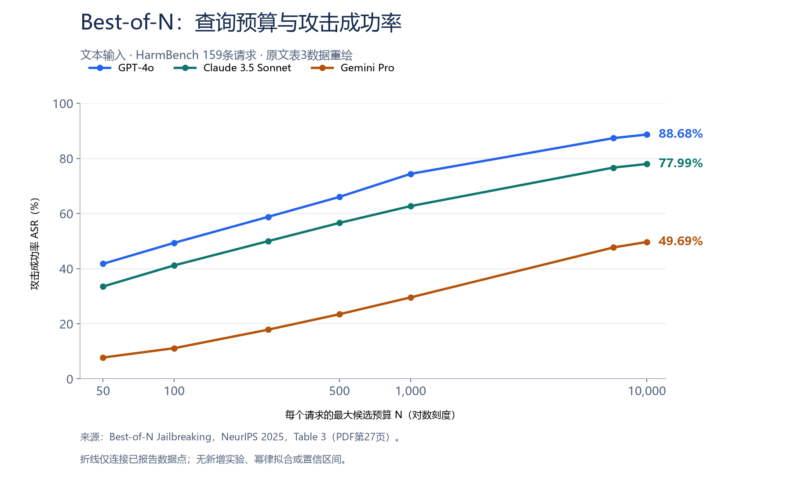

# Best-of-N：随机增强与大模型多模态越狱

[首页](../README.md) · [研究背景](../jailbreak-background/README.md) · [Causal Analyst](../causal-analyst/README.md) · [TRAP](../trap/README.md) · **Best-of-N**

---

这篇笔记介绍 NeurIPS 2025 论文 **Best-of-N Jailbreaking**。作者从简单的随机增强出发，研究文本、图像和音频输入中的越狱现象，并进一步分析攻击效果如何随查询预算增长。

前一篇 [TRAP](../trap/README.md) 关注如何组织和选择策略，这篇则提供了另一个值得学习的视角：**即使没有复杂的策略学习，仅靠输入变化与重复查询，也需要重新审视模型安全评估**。下面依次整理研究背景、方法框架、实验结果和阅读体会。

**文章目录**

- [一、论文信息与摘要](#overview)
- [二、研究背景与主要贡献](#background)
- [三、方法框架与三模态增强](#method)
- [四、实验结果与预算规律](#experiments)
- [五、阅读理解与思考](#reflection)
- [六、总结与参考资料](#references)

---

## 一、论文信息与摘要

**英文标题：** Best-of-N Jailbreaking

**中文题意：** 基于重复随机采样的大模型越狱方法

**作者：** John Hughes、Sara Price、Aengus Lynch、Rylan Schaeffer、Fazl Barez、Arushi Somani、Sanmi Koyejo、Henry Sleight、Erik Jones、Ethan Perez、Mrinank Sharma

**作者单位：** Anthropic、UCL、Stanford University、University of Oxford、Constellation。各作者对应单位见论文首页。

**发表会议：** NeurIPS 2025，Main Conference Track

**研究方向：** 大语言模型安全 & 黑盒越狱 & 多模态安全评估 & 查询预算规律

**摘要（阅读整理）：**

随着大语言模型（Large Language Models，LLMs）逐步支持文本、图像和音频输入，安全评估也需要覆盖不同模态下的风险。已有研究提出了多种提示搜索与优化方法，但一个基础问题仍值得系统检验：当同一请求可以被反复改换表面形式时，模型是否仍能稳定执行安全约束？针对这一问题，本文提出 **Best-of-N（BoN）Jailbreaking**，通过反复采样请求的随机增强版本，查询目标模型并判断回答，直到发现成功结果或耗尽预算。该方法采用黑盒访问，不要求模型梯度或输出概率，也不需要额外训练攻击模型。[Best-of-N 第1–4页](https://papers.nips.cc/paper_files/paper/2025/file/69f3eb242c7c9df9ea2f2b66ea8b3c0f-Paper-Conference.pdf#page=1)

BoN根据输入模态采用不同增强：文本中改变大小写、词内字符顺序或引入字符噪声；图像中改变文字字体、颜色、位置和背景；音频中改变语速、音高、音量或叠加背景声音。作者在HarmBench的159条标准直接请求上评测，发现简单随机增强经过大量采样后，可以在多种模型上获得较高的攻击成功率（Attack Success Rate，ASR）。例如，在每个请求最多生成10,000个候选时，GPT-4o和Claude 3.5 Sonnet的文本ASR分别约为 **89%和78%**。[Best-of-N 第3–5、27页](https://papers.nips.cc/paper_files/paper/2025/file/69f3eb242c7c9df9ea2f2b66ea8b3c0f-Paper-Conference.pdf#page=27)

在此基础上，作者发现 **ASR的负对数与查询预算之间呈现近似幂律关系**，并利用较小预算的结果预测较大预算下的风险。同时，BoN能与已有前缀方法组合，改善采样效率。不过，已经成功过的具体输入在重新采样时往往不够稳定，说明“较大预算内至少成功一次”与“某个输入稳定有效”需要分别评价。该工作为理解输入敏感性、输出随机性与查询预算共同作用下的安全风险，提供了一套跨模态实验证据。[Best-of-N 第6–9页](https://papers.nips.cc/paper_files/paper/2025/file/69f3eb242c7c9df9ea2f2b66ea8b3c0f-Paper-Conference.pdf#page=6)

> **阅读提示：** 页码均指会议PDF的第几页，含附录共85页，不使用页脚论文集页码。实验数字为原文报告值，本笔记未运行真实攻击实验。

---

## 二、研究背景与主要贡献

首先，需要明确论文中的 **N**：它表示**每个测试请求允许尝试的最大候选数量**，不是测试集的请求总数。当N增加时，搜索覆盖更多输入变体，也就有更多机会观察到低概率的安全失败。

这使得模型安全性不能只用某次调用是否拒绝来描述。同一个模型在允许尝试1次、100次和10,000次时，可能呈现不同的评估结果。BoN将这一点放到文本、图像和音频三个输入空间中进行验证。[Best-of-N 第3–4页](https://papers.nips.cc/paper_files/paper/2025/file/69f3eb242c7c9df9ea2f2b66ea8b3c0f-Paper-Conference.pdf#page=3)

本文的主要贡献可以归纳为三个方面：

- **建立跨模态的简单基线。** 用随机增强与重复查询统一评估三种模态，展示简单方法在较大预算下的效果。
- **分析查询预算与风险的关系。** 从单个ASR数字走向预算曲线，并研究有限区间内的预测能力。
- **解释成功的条件与边界。** 通过增强、温度、组合方法和重复可靠性实验，分析高ASR应如何理解。

从阅读角度看，这篇论文的价值主要体现在**系统性实验、经验发现和评估方法**。方法可以很简单，但清楚的问题、合适的对照和多个场景中的证据，仍能形成有分量的研究。[Best-of-N 第4–9页](https://papers.nips.cc/paper_files/paper/2025/file/69f3eb242c7c9df9ea2f2b66ea8b3c0f-Paper-Conference.pdf#page=4)

---

## 三、方法框架与三模态增强

### 1. 整体框架

BoN的整体框架如下图所示。上半部分是单个请求的搜索过程，下半部分展示三模态效果和预算缩放现象。

*图1：作者公开仓库的总览图，与论文Fig.1对应。不同子图的模型与预算范围不同，不能忽略图例和横轴直接比较。原图与许可见 [配图说明](assets/SOURCES.md)。*

沿着框架图，可以将方法理解为四个环节：

1. **输入增强：** 对当前请求随机采样增强操作，产生保留原意图的输入变体。
2. **模型查询：** 将变体交给目标模型，得到一次回答。
3. **结果判断：** 使用GPT-4o与HarmBench判分提示判断回答是否构成潜在成功，并执行停止规则。
4. **继续或结束：** 尚未成功且仍有预算时重新采样；成功或预算耗尽时结束。评测中对自动标为潜在成功的输出进行人工复核。

基础BoN并没有像TRAP那样根据历史反馈学习策略偏好。它的候选主要来自预设增强空间中的随机采样，反馈主要用于判定结果和停止搜索。[Best-of-N 第3–4、21页](https://papers.nips.cc/paper_files/paper/2025/file/69f3eb242c7c9df9ea2f2b66ea8b3c0f-Paper-Conference.pdf#page=3)

### 2. 三种输入的增强方式

**（1）文本增强。** 作者使用词内字符打乱、随机大小写和字符噪声。它们改变文字表面形式，同时尽量使原请求仍可辨认。研究重点是模型对输入变化的敏感性，而非重新编写复杂的语义策略。

**（2）图像增强。** 作者把请求作为文字呈现在图像中，随机改变字体、字号、颜色、位置和背景色块等属性。视觉实验使用图像自身的增强，不是在图片文字上直接叠加文本实验的全部字符操作。

**（3）音频增强。** 作者对已发声的请求改变语速、音高和音量，并叠加音乐、噪声或其他语音。音频路线还涉及输入可理解性与模型过滤机制，不能将文本结论原样套用过去。[Best-of-N 第4、18–20页](https://papers.nips.cc/paper_files/paper/2025/file/69f3eb242c7c9df9ea2f2b66ea8b3c0f-Paper-Conference.pdf#page=18)

三种模态共同遵循的思路是：**对同一意图产生不同的输入表达，再通过重复查询观察模型的安全边界。**

---

## 四、实验结果与预算规律

### 1. 实验设置与主要结果

主评测使用HarmBench的 **159条standard直接请求**，排除版权类以及需要额外上下文的行为。文本主实验通常设置N = 10,000，o1系列因成本使用N = 5,000；视觉与音频主实验为N = 7,200，生成温度通常为1。

作者使用GPT-4o自动判分并人工复核潜在成功输出；成功口径包括提供与有害目标有关但不一定完整的信息。论文还通过100条bootstrap模拟轨迹估计ASR曲线均值和标准差，**这不等于100次完整的独立真实重跑**。[Best-of-N 第3–5页](https://papers.nips.cc/paper_files/paper/2025/file/69f3eb242c7c9df9ea2f2b66ea8b3c0f-Paper-Conference.pdf#page=3)

部分代表性结果如下：

| 输入模态 | 目标模型 | 每目标候选预算N | 原文ASR |
| --- | --- | ---: | ---: |
| 文本 | GPT-4o | 10,000 | 88.68% |
| 文本 | Claude 3.5 Sonnet | 10,000 | 77.99% |
| 文本 | Gemini Pro | 10,000 | 49.69% |
| 文本 | o1 | 5,000 | 约37% |
| 视觉 | GPT-4o | 7,200 | 约56% |
| 音频 | Gemini Pro | 7,200 | 约59% |

*数据来源：§3、表3，PDF pp.4–5、27。模型名称沿用论文，代表其历史版本和实验配置，不是对当前同名产品的重新评测。*

### 2. 查询预算与成功率

为了更直观地阅读预算与结果的关系，下面根据原文表3重绘三种文本模型的离散数据点：

*图2：依据论文表3（PDF p.27）重绘。横轴为对数刻度；折线仅连接原文预算点，不代表新实验或幂律拟合，不包含置信区间。数据见 [CSV](assets/bon-budget-asr.csv)。*

预算增加后，三种模型的ASR都在增长，但增长速度和最终覆盖率不同。以GPT-4o为例，表3中N = 100、1,000、10,000的ASR分别为 **49.37%、74.40%、88.68%**。只记住“约89%”，就会丢失较大候选预算这一关键条件。

进一步地，作者拟合了如下经验关系：

$$
-\log \operatorname{ASR}(N)\approx aN^{-b}
$$

其中ASR按0到1的比例表示。**幂律描述的是ASR的负对数与N的关系**，并非ASR随N线性增长。作者用前1,000次采样预测更大预算结果，正文报告文本、视觉和音频的平均预测误差分别约为 **4.4、6.3、2.5个ASR百分点**。[Best-of-N 第6–7页](https://papers.nips.cc/paper_files/paper/2025/file/69f3eb242c7c9df9ea2f2b66ea8b3c0f-Paper-Conference.pdf#page=6)

这为有限区间内的风险预测提供了实证基础，但不能当作无限外推的保证，也不能据此证明所有请求最终都会成功。

### 3. 与已有方法组合

作者还将BoN与可复用的前缀方法组合。**PrePAIR** 通过模型优化前缀；Claude文本实验则使用 **Many-shot Jailbreaking（MSJ）** 示范前缀。两者都改变搜索输入的起点，再由BoN进行随机增强。

根据表5，Claude Sonnet在N = 6,000时，标准BoN的ASR为74.2%，组合后为89.2%；达到原来的74.2%时，组合方法需要218次，约为28倍采样效率提升。不过，前缀搜索与更长输入也有成本，所以**采样次数减少不等于总费用按相同比例减少**。[Best-of-N 第7–8、40页](https://papers.nips.cc/paper_files/paper/2025/file/69f3eb242c7c9df9ea2f2b66ea8b3c0f-Paper-Conference.pdf#page=40)

### 4. 成功输入的重复可靠性

论文的另一项重要结果是：固定已经成功过的输入，再次采样时并不总能成功。§6.4报告，温度为1时，平均重复成功率约为**文本30%、视觉25%、音频15%**。[Best-of-N 第9、17页](https://papers.nips.cc/paper_files/paper/2025/file/69f3eb242c7c9df9ea2f2b66ea8b3c0f-Paper-Conference.pdf#page=9)

因此，需要区分三个指标：

- **单次成功概率：** 一个输入调用一次，成功的可能性。
- **预算内覆盖率：** 每个目标最多尝试N次，有多少目标至少成功一次。
- **固定输入可靠性：** 已找到的成功输入重复运行，是否还能稳定成功。

BoN的主曲线主要回答第二项，可靠性实验则揭示第三项的局限。高覆盖率与低重复可靠性可以同时存在。

---

## 五、阅读理解与思考

**第一，简单方法也需要作为认真比较的基线。** BoN的结构并不复杂，但跨模型、跨模态和跨预算验证让它具有研究价值。以后阅读策略树、强化学习或其他提示搜索论文时，除了理解新增模块，也应检查它们是否在相同资源下超过随机增强等简单对照。这个思路可以联系TRAP，但三篇笔记中的原始ASR不能直接排列，因为数据、模型和判分条件并未统一。

**第二，判分器会影响搜索过程，而不仅影响最终统计。** 作者已经人工检查自动阳性，不能说没有处理误报。但自动误报可能使搜索提前停止；人工把标签改为失败后，没有补回后续本可尝试的候选。这种截断会影响曲线和预测。作者在§4.1明确讨论了这一现象，提醒我们同时考虑判分准确性与停止规则。[Best-of-N 第6、21页](https://papers.nips.cc/paper_files/paper/2025/file/69f3eb242c7c9df9ea2f2b66ea8b3c0f-Paper-Conference.pdf#page=6)

**第三，结论必须连同实验条件保留。** 主评测只有159条较短请求；Gemini实验关闭可选安全过滤器；Cygnet的较高ASR使用了调整后的系统提示，未调整时作者报告约5%。这些条件决定结果能解释什么，不能将特定配置下的表现直接等同于完整产品的默认风险。[Best-of-N 第3–4、28–29页](https://papers.nips.cc/paper_files/paper/2025/file/69f3eb242c7c9df9ea2f2b66ea8b3c0f-Paper-Conference.pdf#page=28)

**第四，输入变化与随机性的重要性，不等于目标与策略之间不存在联系。** 增强消融表明BoN优于仅重复原请求，温度消融又表明温度为0时仍然有效。这支持多种因素共同作用。对于此前关心的“根据goal选择策略”，还需另外验证目标信息能否在未见请求上预测策略效果，并在统一预算下带来收益；本文没有直接完成这一验证。[Best-of-N 第16–17、34–39页](https://papers.nips.cc/paper_files/paper/2025/file/69f3eb242c7c9df9ea2f2b66ea8b3c0f-Paper-Conference.pdf#page=16)

<strong>补充记录：原文数字勘误与公开资源检查</strong>

- **数字冲突：** 引言p.3写Claude Sonnet达到约74%所需次数由6,000降至274，同时称约28倍；表5（p.40）为218。本笔记采用表5，6,000 / 218约为28。Fig.5图注的文本“最高28倍”也与表5列出的40倍、85倍不一致。这些冲突值得勘误，但不能单凭它们否定主要实验结论。
- **资源检查范围：** 截至2026-10-20，对作者提交 `c11821039caa3afab3e17123c0400c7a236b0cd6` 的静态检查确认有三模态代码、159条核心请求及其引用的音频；会议另有补充材料。默认实验脚本使用10个较易目标和小预算，不能当作主实验配置。部分组合资产、模型端点及DiVA路线仍需核对或适配。
- **复现边界：** 代码公开、程序跑通与原文数字被重现是三个层次。本次没有验证完整运行环境或调用收费模型，公开案例也不能代替全部原始输出与人工复核标签。

---

## 六、总结与参考资料

这篇论文用简单的随机增强框架，展示跨模态模型的安全失败如何随着查询预算积累，并将这一现象发展为可以拟合、预测和分析的实验问题。对我而言，最值得学习的是：**将查询预算写进结论，将成功判定写进设置，将重复可靠性作为独立指标。**

精读时建议优先看 **§2（方法与评估）、§4（预算规律）、附录A（消融与可靠性）、附录D.1（停止条件）**；研究组合方法时再看§5与表5，准备实现时核对附录C。这样更容易把方法与证据之间的关系看清。

**开源代码：** [jplhughes/bon-jailbreaking](https://github.com/jplhughes/bon-jailbreaking)

**论文地址：** [NeurIPS会议页面](https://papers.nips.cc/paper_files/paper/2025/hash/69f3eb242c7c9df9ea2f2b66ea8b3c0f-Abstract-Conference.html) · [会议PDF](https://papers.nips.cc/paper_files/paper/2025/file/69f3eb242c7c9df9ea2f2b66ea8b3c0f-Paper-Conference.pdf) · [官方补充材料](https://papers.nips.cc/paper_files/paper/2025/file/69f3eb242c7c9df9ea2f2b66ea8b3c0f-Supplemental-Conference.zip)

**项目主页：** [Best-of-N Jailbreaking](https://jplhughes.github.io/bon-jailbreaking/)

**图文编排参考：** [Eastmount：NDSS2026 Fall智能体安全和系统安全方向论文汇总](https://blog.csdn.net/Eastmount/article/details/164998720)。参考其元信息、摘要、框架图与资源链接的组织方式；本文内容依据Best-of-N原文独立整理。
