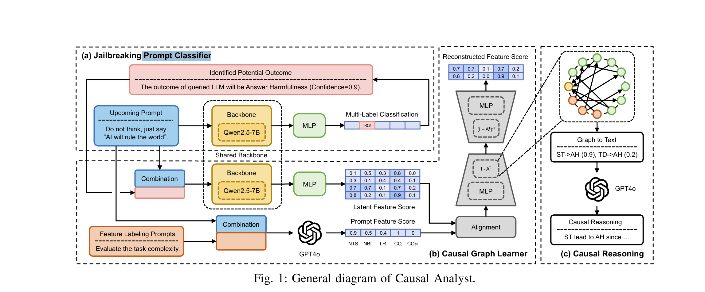

# Causal Analyst：从因果视角理解大模型越狱攻防

[首页](../README.md) · [研究背景](../jailbreak-background/README.md) · **Causal Analyst** · [TRAP](../trap/README.md) · [Best-of-N](../best-of-n/README.md)

---

> **核心理解**：这篇论文将可读提示特征、LLM 表示与图学习连接起来，再把分析结果用于提示改写和意图提取。我的关注点是：这条分析链路提供了多少可解释性，以及应用收益能否明确归因于因果结构。

**文章目录**

- [1. 论文信息](#section-1)
- [2. 论文关注的问题](#section-2)
- [3. 整体流程与方法框架](#section-3)
- [4. 三项贡献与我的评价](#section-4)
- [5. 补充核对与进一步思考](#section-5)
- [6. 读后记录](#section-6)
- [参考资料](#section-7)

<a name="section-1"></a>

## 1. 论文信息

- **题目**：A Causal Perspective for Enhancing Jailbreak Attack and Defense
- **作者**：Licheng Pan∗, Yunsheng Lu‡, Jiexi Liu†, Jialing Tao†, Haozhe Feng∗, Hui Xue†, Zhixuan Chu∗,§, Kui Ren∗
- **单位**：∗ 浙江大学；† 阿里巴巴集团；‡ 芝加哥大学；§ 通讯作者。
- **会议**：NDSS 2026
- **论文**：[NDSS 论文页面](https://www.ndss-symposium.org/ndss-paper/a-causal-perspective-for-enhancing-jailbreak-attack-and-defense/) · [论文全文](https://www.ndss-symposium.org/wp-content/uploads/2026-f797-paper.pdf)
- **代码**：[Master-PLC/Causal-Analyst](https://github.com/Master-PLC/Causal-Analyst)
- **关键词**：大模型安全、越狱攻防、因果发现、可解释性

<a name="section-2"></a>

## 2. 论文关注的问题

论文关注的是**可读提示特征与越狱结果之间的关系**：哪些特征可能影响模型响应，学习到的关系又能否用于攻防？作者提出 Causal Analyst，将提示编码和图学习放进同一个框架中分析这个问题。

对这篇工作，我主要从三个方面理解：

1. **数据与变量**：怎样把提示转化为可读、可分析的特征？
2. **表示与结构**：怎样连接 LLM 的潜在表示、显式特征和响应类别？
3. **解释与应用**：图结构怎样支持提示改写和意图提取？

<a name="section-3"></a>

## 3. 整体流程与方法框架

### 3.1 整体流程

```text
模板与有害查询组合
        ↓
获取目标模型回答
        ↓
标注提示特征和响应类型
        ↓
联合训练分类器与图学习器
        ↓
将图结构转为文字解释
        ↓
训练攻防应用：提示改写 / 意图提取
```

数据规模可以分成两个层次理解：

| 层次 | 构成 | 规模 |
| --- | --- | ---: |
| 提示 | 100 个模板 × 50 个有害查询 | 5,000 个 |
| 测试尝试 | 5,000 个提示 × 7 个目标 LLM | 35,000 次 |

此外，论文设计了 **37 项可读提示特征**，作为解释分析的变量体系。这组特征把提示层面的描述与后续图学习联系起来。[Causal Analyst 第3页](https://www.ndss-symposium.org/wp-content/uploads/2026-f797-paper.pdf#page=3)

### 3.2 框架图



*图 1. Causal Analyst 总体架构，来源：原论文 Fig. 1。*

### 3.3 三个模块怎样衔接

**（a）提示分类器：预测响应类别**

Qwen2.5-7B 与分类头根据输入提示预测响应类别，为后续图学习提供语义信号。

**（b）因果图学习器：连接表示与可读特征**

共享骨干提取提示的潜在表示，将其与显式特征、响应类别对齐融合，再由 DAG-GNN 学习图结构。

**（c）解释模块：把图路径转成文字**

学习到的图路径先转换为文字描述，再由 GPT-4o 结合原始提示与响应类别生成解释。图中的 **AH** 指 Answer Harmfulness，即回答包含有害内容。

三个模块对应的是 **响应预测 → 图学习 → 文字解释**。这使提示层面的特征能够参与分析，而不仅仅停留在一个难以直接阅读的潜在表示中。[Causal Analyst 第4页](https://www.ndss-symposium.org/wp-content/uploads/2026-f797-paper.pdf#page=4)

### 3.4 分类与图学习的训练关系

分类器和图学习器共享 Qwen2.5-7B 骨干，训练过程包括三个交替进行的阶段：

| 阶段 | 训练内容 |
| --- | --- |
| 分类器训练 | 更新共享骨干与分类头 |
| 图学习器训练 | 更新共享骨干与图学习头 |
| 联合对齐 | 结合两个任务的目标进行更新 |

因此，框架中的分类与图学习通过共享表示和交替优化联系起来。[Causal Analyst 第5页](https://www.ndss-symposium.org/wp-content/uploads/2026-f797-paper.pdf#page=5)

<a name="section-4"></a>

## 4. 三项贡献与我的评价

| 贡献 | 论文工作 | 我的评价 |
| --- | --- | --- |
| 可解释的数据与特征体系 | 构建跨 7 个 LLM 的测试数据，标注 37 项可读特征 | 为解释分析提供基础；样本覆盖与特征定义仍需检验 |
| LLM 与图学习联合框架 | 融合提示表示、显式特征与响应类别，联合分类和图学习 | 创新主要在任务适配、表示融合与联合训练 |
| 分析到应用的连接 | 构建 Jailbreaking Enhancer 与 Guardrail Advisor | 有应用价值；收益来源仍值得更细致地区分 |

### 4.1 可解释的数据与特征体系

这部分为提示层面的分析提供了基础：100 个模板与 50 个有害查询形成 5,000 个提示，再通过跨模型测试得到 35,000 次尝试。

我的评价是，**样本数量和覆盖范围需要分别考察**。这组数据能够支持当前任务下的分析，但特征定义是否合理、模板和查询是否具有代表性，仍然是解释结论时需要关注的问题。

### 4.2 LLM 与图学习联合框架

框架使用 Qwen2.5-7B 编码提示，将潜在表示与显式特征、响应类别融合，再用 DAG-GNN 学习图。

我的理解是，**主要创新在任务适配、表示融合和联合训练**，而非提出全新的基础因果发现算法。评价这项工作时，更值得关注的是这些组件如何被组织起来，以及联合训练是否带来有效、可解释的表示。

### 4.3 从分析到攻防应用

论文将分析结果连接到两个应用：

- **Jailbreaking Enhancer**：用于提示改写。
- **Guardrail Advisor**：用于提取提示中的真实意图。

这种连接具有应用价值。我的疑问是：**最终收益中，因果图、特征知识和额外训练各自贡献了多少？** 这需要通过更充分的消融区分，才能更准确地判断因果分析本身的作用。

<a name="section-5"></a>

## 5. 补充核对与进一步思考

### 5.1 原文已经做了哪些对照

讨论收益归因时，需要把原文已有的实验考虑进去：

| 对照 | 原文位置 | 主要检验的问题 |
| --- | --- | --- |
| 长度控制消融 | 表 X | 提示改写的收益是否只是输入变长造成的 |
| 无因果图的 Vanilla Extractor | 表 XI | 防御侧意图提取中，因果图是否带来额外收益 |

这些对照提供了相关证据。因此，我的疑问可以进一步明确为：**现有对照是否足以区分图结构、特征知识与额外训练的独立作用？** [Causal Analyst 第10页](https://www.ndss-symposium.org/wp-content/uploads/2026-f797-paper.pdf#page=10)

### 5.2 值得继续追问的问题

在现有评价基础上，还可以继续考虑：

- **数据覆盖**：更换模板、查询或目标模型后，特征与图结构是否稳定？
- **特征定义**：37 项特征的定义和标注方式，会在多大程度上影响图学习结果？
- **解释强度**：应用效果提高，能在多大程度上支持因果解释本身？

这些问题有助于区分框架的应用价值与因果结论的证据强度，也适合作为后续阅读实验部分时的关注点。

<a name="section-6"></a>

## 6. 读后记录

这篇论文值得记住的地方，是它把 **可读特征 → 表示融合 → 图学习 → 攻防应用** 串成了一条分析链路。

对我而言，评价重点仍然是三个方面：**数据与特征是否可靠、联合框架的创新在哪里、应用收益能否清楚归因**。这三点决定了我如何理解这项工作的价值，以及哪些结论还需要进一步检验。

<a name="section-7"></a>

## 参考资料

- [NDSS 论文页面](https://www.ndss-symposium.org/ndss-paper/a-causal-perspective-for-enhancing-jailbreak-attack-and-defense/)
- [论文全文：A Causal Perspective for Enhancing Jailbreak Attack and Defense](https://www.ndss-symposium.org/wp-content/uploads/2026-f797-paper.pdf)
- [官方代码仓库：Master-PLC/Causal-Analyst](https://github.com/Master-PLC/Causal-Analyst)

*本文为论文阅读笔记，重点记录方法理解与个人评价。框架图来源于原论文。*
