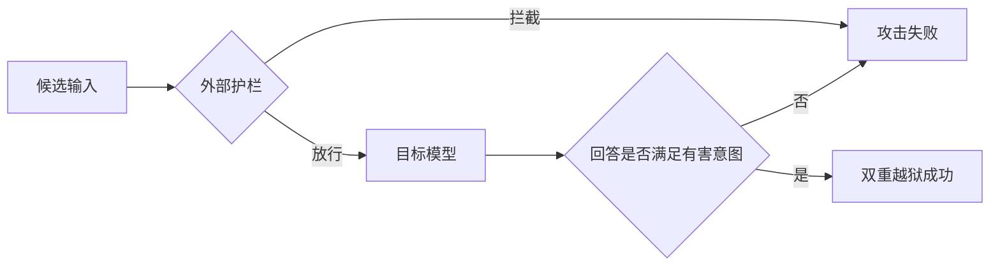

# DUALBREACH：先在本地练习，再跨过两道安全防线

[首页](../README.md) · [研究背景](../jailbreak-background/README.md) · [Causal Analyst](../causal-analyst/README.md) · [TRAP](../trap/README.md) · [Best-of-N](../best-of-n/README.md) · **DUALBREACH**

> **论文：** *DUALBREACH: Efficient Dual-Jailbreaking via Target-Driven Initialization and Multi-Target Optimization* · NDSS 2026 
> **作者：** Xinzhe Huang、Kedong Xiu、Tianhang Zheng 等，浙江大学 
> [论文页面](https://www.ndss-symposium.org/ndss-paper/dualbreach-efficient-dual-jailbreaking-via-target-driven-initialization-and-multi-target-optimization/) · [作者代码](https://github.com/hxz-sec/DualBreach)

## 一次拒绝，能说明系统安全吗？

把有害请求直接交给模型，观察它是否拒绝，是理解越狱的起点。但真实应用还可能在模型前放一道外部护栏：输入先接受检查，放行后才轮到模型回答。

于是，攻击遇到两个可能冲突的要求：**输入要让护栏愿意放行，又要让模型给出符合有害意图的回答**。只通过其中一道，都不算攻破整套系统。这就是 DUALBREACH 研究的“双重越狱”。[论文§I、§III，pp.1–4][problem]

*研究中的裁判负责判断回答是否成功；它与负责放行输入的外部护栏是不同角色。*

## 真实系统不适合无限试，先把练习搬到本地

面对两道防线，反复在线改写提示词既费查询，也难以直接获得优化方向。作者因此把大部分搜索放到本地，先准备一条有希望的输入，再尝试让它同时适应两边。

第一步是 **目标驱动初始化（TDI）**：从希望获得的回答出发，反推可能引出它的提示词，为搜索选择起点。

第二步是 **多目标优化（MTO）**：在本地护栏和语言模型上调整同一条提示词，兼顾降低护栏风险判断、提高目标回答倾向。优化后的候选再提交真实系统，验证效果能否迁移。[论文§IV，pp.6–8][method]

这里最容易混淆的是“本地替身”从哪里来。**护栏一侧**可以直接使用公开模型，也可以用黑盒护栏的反馈训练代理；**语言模型一侧**使用已有本地模型，例如 Llama-3。论文没有报告把 GPT-4 等目标模型蒸馏到本地。最终迁移的是提示词的攻击效果，而非目标模型本身。[论文§IV-B、§V-A，pp.6–9][method]

## 实验显示有效，但“1.77 次”需要连同口径阅读

在 **Llama-Guard-3 保护 GPT-4** 的设置中，DUALBREACH 在 AdvBench、Do-Not-Answer、HarmBench 三个数据集上各测试100个请求，双重成功率分别为 **91%、98%、92%**，平均 **93.67%**；对照方法 PAP 的平均值为88.33%。这支持整套框架在该设置中的效果，但不代表每个数据集、每种模型上都胜过所有基线。[论文§V、表II，pp.9–10][results]

同一设置还报告平均每次成功只需 **1.77 次查询**。不过，这个均值**只统计成功样本**，没有把失败任务的消耗、代理准备和本地计算合成一个完整成本。因此，它说明成功案例中的在线查询较少，不能读成“每个任务总共只花约两次调用”。[表II脚注，p.10][results]

## 绕过护栏，也可能停在模型面前

最能说明“两道防线”区别的，是论文的一次提交实验：在 AdvBench 上，DUALBREACH 的 Guard3 通过率达到 **97%**，但面对 Llama-3 时，双重成功率为 **44%**。输入看起来足够正常，不代表模型会完成攻击目标。[表III，p.11][oneshot]

作者随后提出集成防御 **EGuard**，组合多个护栏的判断。在 AdvBench 上，它将 DUALBREACH 的护栏通过率从97%降至90%。这说明组合判断能补上一部分漏洞，也说明防御远未解决问题；这里统计的仍是护栏通过率，不能与前面的双重成功率混用。[§VI、表VIII，pp.12–14][defense]

## 这篇论文留给我的判断

DUALBREACH 的设计逻辑很清楚：**防线有两道，优化就要兼顾两道；真实查询有限，就先在本地搜索；本地表现改善后，还要让真实系统验证。**

它值得学习的是把攻击对象从单个模型扩展到“护栏＋模型”的完整链路。继续追问的则是：初始化、代理和联合优化各自贡献多少？失败任务与准备成本计入后，效率优势还有多大？现有结果展示了整套框架的效果，尚不能把收益精确归给每一个组件。

联系前两种搜索思路：[Best-of-N](../best-of-n/README.md) 用随机增强扩大尝试，[TRAP](../trap/README.md) 用历史反馈选择策略，DUALBREACH 则把重点放在两道防线的共同约束上。三者的原始成功率不能直接排名，仍需统一模型、预算与判分条件。

---

**阅读范围：** 依据18页论文与已有精读稿压缩整理；页码指PDF页码。文中数字为论文报告结果，本次未运行攻击或复现实验。精读建议：先看图2与§IV，再核对表II的查询脚注、表III的两类成功率。

**完整题目与作者：** DUALBREACH: Efficient Dual-Jailbreaking via Target-Driven Initialization and Multi-Target Optimization；Xinzhe Huang、Kedong Xiu、Tianhang Zheng、Churui Zeng、Wangze Ni、Zhan Qin、Kui Ren、Chun Chen。

[problem]: https://www.ndss-symposium.org/wp-content/uploads/2026-s1062-paper.pdf#page=1
[method]: https://www.ndss-symposium.org/wp-content/uploads/2026-s1062-paper.pdf#page=6
[results]: https://www.ndss-symposium.org/wp-content/uploads/2026-s1062-paper.pdf#page=10
[oneshot]: https://www.ndss-symposium.org/wp-content/uploads/2026-s1062-paper.pdf#page=11
[defense]: https://www.ndss-symposium.org/wp-content/uploads/2026-s1062-paper.pdf#page=13
