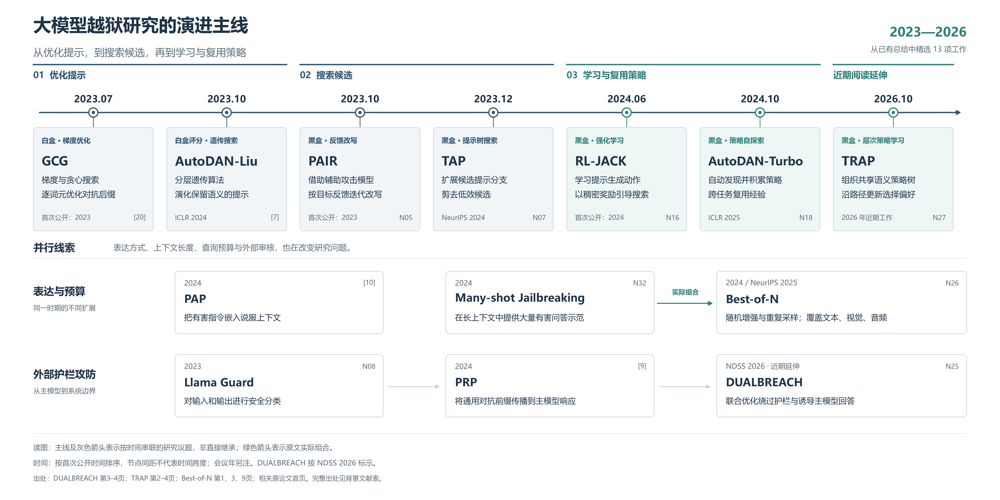
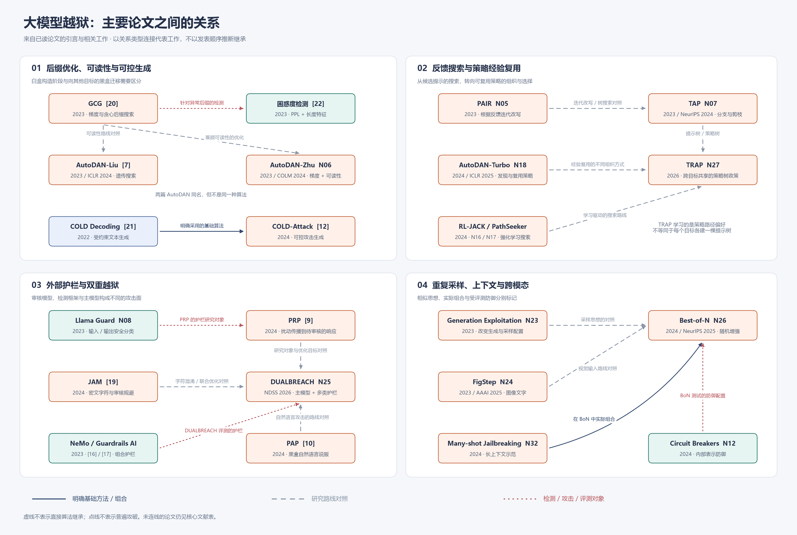

# 大模型越狱：背景与历史研究

[首页](../README.md) · **研究背景** · [Causal Analyst](../causal-analyst/README.md) · [TRAP](../trap/README.md) · [Best-of-N](../best-of-n/README.md)

---

46 项文献与工具，按年份梳理越狱攻击、护栏与防御。核心贡献依原文忠实转述，背景未详述时补查原论文；出处按 PDF 第1页起计，保留原编号，新增条目用 N 编号。

[研究时间线](#timeline) · [核心文献表](#literature) · [主要论文关系](#relations)

## 研究时间线

从 46 项总结中精选 13 项代表工作，以“自动化构造 → 黑盒搜索 → 策略学习与复用”为阅读主线，并列展示表达与预算、外部护栏攻防两条线索。2026 工作标为近期延伸。

[高清 PNG](assets/大模型越狱研究时间线.png) · [可编辑 SVG](assets/大模型越狱研究时间线.svg) · [PDF](assets/大模型越狱研究时间线.pdf) · [图中文字与出处](资料/时间线图依据.json)

*节点按时间排序，间距不表示实际时间跨度；主线是研究议题串联，非直接继承。绿色连线表示 Many-shot 与 BoN 在原文中的实际组合。SVG 使用微软雅黑，文字可编辑。*

## 核心文献表

| 编号 | 年份 | 工作（论文链接） | 作者 | 分类 / 访问条件 | 核心贡献（据原文转述） | 原文出处（PDF页码） |
| --- | --- | --- | --- | --- | --- | --- |
| N01 | 2022 | [InstructGPT / RLHF](https://arxiv.org/abs/2203.02155) | L. Ouyang 等 | 基础·对齐训练 | 先用人工示范监督微调，再利用人工对模型输出的排序进行人类反馈强化学习。 | [InstructGPT](https://arxiv.org/pdf/2203.02155#page=1) 第1页 |
| N02 | 2022 | [Constitutional AI](https://arxiv.org/abs/2212.08073) | Y. Bai 等 | 基础·AI 反馈对齐 | 以原则指导模型自我批评和修订，再利用模型评判得到的偏好进行 AI 反馈强化学习。 | [Constitutional AI](https://arxiv.org/pdf/2212.08073#page=1) 第1页 |
| [21] | 2022（NeurIPS） | [COLD Decoding](https://proceedings.neurips.cc/paper_files/paper/2022/hash/3e25d1aff47964c8409fd5c8dc0438d7-Abstract-Conference.html) | L. Qin 等 | 基础·可控生成 | 用能量函数表达文本约束，通过朗之万动力学进行梯度采样，实现受约束文本生成。 | [COLD Decoding](https://papers.neurips.cc/paper_files/paper/2022/file/3e25d1aff47964c8409fd5c8dc0438d7-Paper-Conference.pdf#page=1) 第1–2页 |
| N29 | 2022（服务发布） | [OpenAI Moderation](https://openai.com/index/new-and-improved-content-moderation-tooling/) | OpenAI | 护栏·API | 仅向用户提供 API，对给定输入返回审核评估结果。 | [DUALBREACH](https://www.ndss-symposium.org/wp-content/uploads/2026-s1062-paper.pdf#page=4) 第4页 |
| [15] | 2023；2024 修订 | [GPT-4 Technical Report](https://arxiv.org/abs/2303.08774) | OpenAI / J. Achiam 等 | 基础·模型报告 | 报告可接收图像与文本输入、生成文本输出的多模态模型 GPT-4，并介绍其能力和对齐。 | [GPT-4 报告](https://arxiv.org/pdf/2303.08774#page=1) 第1页 |
| N03 | 2023（NeurIPS） | [Jailbroken](https://arxiv.org/abs/2307.02483) | A. Wei 等 | 机制·安全失效 | 提出目标冲突、安全泛化不匹配两种失效模式假设，并据此指导越狱设计。 | [Jailbroken](https://arxiv.org/pdf/2307.02483#page=1) 第1页 |
| [20] | 2023 | [GCG / AdvBench](https://arxiv.org/abs/2307.15043) | A. Zou 等 | 攻击·自然语言·白盒·后缀搜索 | 执行逐词元梯度搜索，优化越狱提示。 | [DUALBREACH](https://www.ndss-symposium.org/wp-content/uploads/2026-s1062-paper.pdf#page=3) 第3页 |
| [22] | 2023 | [困惑度检测](https://arxiv.org/abs/2308.14132) | G. Alon、M. Kamfonas | 护栏·函数 / 特征 | 通过分析提示的困惑度，识别 GCG 等方法生成的异常字符串后缀。 | [DUALBREACH](https://www.ndss-symposium.org/wp-content/uploads/2026-s1062-paper.pdf#page=4) 第4页 |
| N09 | 2023 | [Baseline Defenses](https://arxiv.org/abs/2309.00614) | N. Jain 等 | 防御·过滤 / 输入处理 | 研究困惑度检测、输入预处理（改写与重新分词）和对抗训练三类防御。 | [Baseline Defenses](https://arxiv.org/pdf/2309.00614#page=1) 第1页 |
| [24] | 2023（官方博客） | [Google Text Moderation](https://cloud.google.com/blog/products/ai-machine-learning/google-cloud-text-moderation/) | C. Hawker、E. Koukoumidis | 护栏·API | 仅向用户提供 API，对给定输入返回审核评估结果。 | [DUALBREACH](https://www.ndss-symposium.org/wp-content/uploads/2026-s1062-paper.pdf#page=4) 第4页 |
| N04 | 2023 | [GPTFuzzer](https://arxiv.org/abs/2309.10253) | J. Yu 等 | 攻击·黑盒·模糊测试 | 通过变异种子提示，自动探索越狱提示。 | [TRAP](https://arxiv.org/pdf/2610.17313v1#page=3) 第3页 |
| [7] | 2023；ICLR 2024 | [AutoDAN-Liu](https://arxiv.org/abs/2310.04451) | X. Liu 等 | 攻击·自然语言·白盒评分·遗传搜索 | 使用遗传算法演化有效的越狱提示。 | [DUALBREACH](https://www.ndss-symposium.org/wp-content/uploads/2026-s1062-paper.pdf#page=3) 第3页 |
| N22 | 2023 | [Shadow Alignment](https://arxiv.org/abs/2310.02949) | X. Yang 等 | 攻击·恶意微调 | 在恶意数据上对模型组件进行对抗性微调，破坏安全对齐。 | [Causal Analyst](https://www.ndss-symposium.org/wp-content/uploads/2026-f797-paper.pdf#page=2) 第2页 |
| [25] | 2023；2024 修订 | [SmoothLLM](https://arxiv.org/abs/2310.03684) | A. Robey 等 | 防御·随机扰动 | 生成对抗输入的多个随机扰动副本，通过多数投票聚合响应。 | [DUALBREACH](https://www.ndss-symposium.org/wp-content/uploads/2026-s1062-paper.pdf#page=4) 第4页 |
| N23 | 2023；ICLR 2024 | [Generation Exploitation](https://arxiv.org/abs/2310.06987) | Y. Huang 等 | 攻击·生成配置 | 探索不同的解码方式以诱发越狱。 | [Best-of-N Jailbreaking](https://proceedings.neurips.cc/paper_files/paper/2025/file/69f3eb242c7c9df9ea2f2b66ea8b3c0f-Paper-Conference.pdf#page=9) 第9页 |
| N31 | 2023 | [ICA / ICD](https://arxiv.org/abs/2310.06387) | Z. Wei 等 | 攻防·上下文示范 | ICA 利用有害示范诱导越狱；ICD 利用拒绝有害请求的示范增强防御。 | [ICA / ICD](https://arxiv.org/pdf/2310.06387#page=1) 第1页 |
| N05 | 2023；SaTML 2025 | [PAIR](https://arxiv.org/abs/2310.08419) | P. Chao 等 | 攻击·黑盒·反馈改写 | 借助辅助攻击模型，迭代改写提示。 | [TRAP](https://arxiv.org/pdf/2610.17313v1#page=4) 第4页 |
| [16] | 2023（EMNLP Demo） | [NeMo Guardrails](https://aclanthology.org/2023.emnlp-demo.40/) | T. Rebedea 等 | 护栏·组合 / 可编程 | 集成多种检测工具，从不同角度识别越狱提示。 | [DUALBREACH](https://www.ndss-symposium.org/wp-content/uploads/2026-s1062-paper.pdf#page=4) 第4页 |
| [17] | 2023（原引用年份） | [Guardrails AI](https://www.guardrailsai.com/) | Guardrails AI | 护栏·组合 / 验证器 | 集成多种检测工具，从不同角度识别越狱提示。 | [DUALBREACH](https://www.ndss-symposium.org/wp-content/uploads/2026-s1062-paper.pdf#page=4) 第4页 |
| N06 | 2023；COLM 2024 | [AutoDAN-Zhu](https://arxiv.org/abs/2310.15140) | S. Zhu 等 | 攻击·白盒·可读性优化 | 同时优化越狱效果与可读性，利用梯度从左到右逐词元生成提示。 | [AutoDAN-Zhu](https://arxiv.org/pdf/2310.15140#page=1) 第1页 |
| N24 | 2023；AAAI 2025 | [FigStep](https://arxiv.org/abs/2311.05608) | Y. Gong 等 | 攻击·黑盒·视觉排版 | 通过包含有害排版文字的图像，绕过视觉语言模型的安全限制。 | [Best-of-N Jailbreaking](https://proceedings.neurips.cc/paper_files/paper/2025/file/69f3eb242c7c9df9ea2f2b66ea8b3c0f-Paper-Conference.pdf#page=9) 第9页 |
| [26] | 2023；ACL 2024 | [Goal Prioritization](https://arxiv.org/abs/2311.09096) | Z. Zhang 等 | 防御·提示 / 训练 | 在解码时前置安全优先指令，要求模型在回答前先评估提示安全性。 | [DUALBREACH](https://www.ndss-symposium.org/wp-content/uploads/2026-s1062-paper.pdf#page=4) 第4页 |
| N30 | 2023 | [Bergeron](https://arxiv.org/abs/2312.00029) | M. Pisano 等 | 护栏·辅助 LLM | 使用第二个 LLM 作为守卫，检查主模型的输入和输出，无需额外参数微调。 | [Bergeron](https://arxiv.org/pdf/2312.00029#page=1) 第1页 |
| N07 | 2023；NeurIPS 2024 | [TAP](https://arxiv.org/abs/2312.02119) | A. Mehrotra 等 | 攻击·黑盒·树搜索 | 针对每个攻击目标分别建立提示树，通过扩展与剪枝搜索提示。 | [TRAP](https://arxiv.org/pdf/2610.17313v1#page=4) 第4页 |
| N08 | 2023 | [Llama Guard](https://arxiv.org/abs/2312.06674) | H. Inan 等 | 护栏·安全分类 LLM | 根据安全风险分类体系微调 LLM，对输入和输出进行安全分类并生成风险标签。 | [Llama Guard](https://arxiv.org/pdf/2312.06674#page=1) 第1页 |
| [10] | 2024（ACL） | [PAP](https://aclanthology.org/2024.acl-long.773/) | Y. Zeng 等 | 攻击·黑盒·自然语言说服 | 将有害指令嵌入有说服力的上下文，无需访问模型内部即可诱导不安全回答。 | [DUALBREACH](https://www.ndss-symposium.org/wp-content/uploads/2026-s1062-paper.pdf#page=3) 第3页 |
| N13 | 2024（ICML） | [HarmBench](https://arxiv.org/abs/2402.04249) | M. Mazeika 等 | 评测·红队 / 稳健拒答 | 提出标准化自动红队评测框架，并提供高效的对抗训练方法。 | [HarmBench](https://arxiv.org/pdf/2402.04249#page=1) 第1页 |
| [12] | 2024（ICML） | [COLD-Attack](https://proceedings.mlr.press/v235/guo24i.html) | X. Guo 等 | 攻击·自然语言·白盒·可控生成 | 将提示生成表述为可控文本生成，使用基于能量的解码与朗之万动力学。 | [DUALBREACH](https://www.ndss-symposium.org/wp-content/uploads/2026-s1062-paper.pdf#page=3) 第3页 |
| N10 | 2024（ACL） | [SafeDecoding](https://aclanthology.org/2024.acl-long.303/) | Z. Xu 等 | 防御·安全感知解码 | 提高安全声明词元的生成概率，同时降低符合越狱目标的词元序列概率。 | [SafeDecoding](https://aclanthology.org/2024.acl-long.303.pdf#page=1) 第1页 |
| [9] | 2024（ACL） | [PRP](https://aclanthology.org/2024.acl-long.591/) | N. Mangaokar 等 | 攻击·输出护栏 | 先构造针对护栏模型的通用对抗前缀，再将此前缀传播到主模型的响应中。 | [PRP](https://aclanthology.org/2024.acl-long.591.pdf#page=1) 第1页 |
| N14 | 2024 | [Rainbow Teaming](https://arxiv.org/abs/2402.16822) | M. Samvelyan 等 | 攻击·黑盒·质量多样性 | 将有效对抗提示的生成建模为质量—多样性搜索问题。 | [Best-of-N Jailbreaking](https://proceedings.neurips.cc/paper_files/paper/2025/file/69f3eb242c7c9df9ea2f2b66ea8b3c0f-Paper-Conference.pdf#page=9) 第9页 |
| N11 | 2024（ACL） | [GradSafe](https://aclanthology.org/2024.acl-long.30/) | Y. Xie 等 | 护栏·安全关键梯度 | 利用输入与肯定回答配对时的安全关键参数梯度模式，检测不安全提示。 | [GradSafe](https://aclanthology.org/2024.acl-long.30.pdf#page=1) 第1页 |
| N32 | 2024 | [Many-shot Jailbreaking](https://www.anthropic.com/research/many-shot-jailbreaking) | C. Anil 等 | 攻击·黑盒·长上下文 | 在长上下文中提供数百个不良行为示范，研究攻击效果随示范数量的扩展规律。 | [Many-shot Jailbreaking](https://www-cdn.anthropic.com/af5633c94ed2beb282f6a53c595eb437e8e7b630/Many_Shot_Jailbreaking__2024_04_02_0936.pdf#page=1) 第1页 |
| [19] | 2024（NeurIPS） | [JAM](https://arxiv.org/abs/2405.20413) | H. Jin 等 | 攻击·非自然语言 / 审核规避 | 诱导目标模型在每个生成词周围添加选定的密文字符，混淆审核护栏。 | [DUALBREACH](https://www.ndss-symposium.org/wp-content/uploads/2026-s1062-paper.pdf#page=3) 第3页 |
| N12 | 2024（NeurIPS） | [Circuit Breakers](https://arxiv.org/abs/2406.04313) | A. Zou 等 | 防御·内部表示 | 直接控制与有害输出相关的内部表示，阻断有害生成。 | [Circuit Breakers](https://arxiv.org/pdf/2406.04313#page=1) 第1页 |
| N16 | 2024 | [RL-JACK](https://arxiv.org/abs/2406.08725) | X. Chen 等 | 攻击·黑盒·强化学习 | 将越狱提示生成建模为搜索问题，结合 LLM 辅助动作空间和稠密奖励进行强化学习。 | [RL-JACK](https://arxiv.org/pdf/2406.08725#page=1) 第1页 |
| N15 | 2024；ICLR 2025 | [h4rm3l](https://arxiv.org/abs/2408.04811) | M. K. B. Doumbouya 等 | 攻击·黑盒·组合搜索 | 将攻击表示为字符串到字符串变换的组合，通过多步迭代优化进行搜索。 | [Best-of-N Jailbreaking](https://proceedings.neurips.cc/paper_files/paper/2025/file/69f3eb242c7c9df9ea2f2b66ea8b3c0f-Paper-Conference.pdf#page=9) 第9页 |
| N17 | 2024 | [PathSeeker](https://arxiv.org/abs/2409.14177) | Z. Lin 等 | 攻击·黑盒·强化学习 | 利用多智能体强化学习，让小模型协作指导主模型变异，并根据目标反馈调整输入。 | [PathSeeker](https://arxiv.org/pdf/2409.14177#page=1) 第1页 |
| N19 | 2024；ICML 2025 | [FlipAttack](https://proceedings.mlr.press/v267/liu25z.html) | Y. Liu 等 | 攻击·黑盒·文本变换 | 采用固定文本变换，不根据目标响应进行迭代改写。 | [TRAP](https://arxiv.org/pdf/2610.17313v1#page=4) 第4页 |
| N18 | 2024；ICLR 2025 | [AutoDAN-Turbo](https://arxiv.org/abs/2410.05295) | X. Liu 等 | 攻击·黑盒·策略自探索 | 跨任务和模型复用已发现的攻击策略。 | [TRAP](https://arxiv.org/pdf/2610.17313v1#page=2) 第2页 |
| N26 | 2024；NeurIPS 2025 | [Best-of-N Jailbreaking](https://arxiv.org/abs/2412.03556) | J. Hughes 等 | 攻击·黑盒·随机增强 | 反复采样提示增强变体，并扩展到视觉和音频输入，研究攻击效果随采样数量的变化。 | [Best-of-N Jailbreaking](https://proceedings.neurips.cc/paper_files/paper/2025/file/69f3eb242c7c9df9ea2f2b66ea8b3c0f-Paper-Conference.pdf#page=1) 第1页 |
| N20 | 2025（ICLR；初稿年待核） | [Sequence of Context / SoC](https://proceedings.iclr.cc/paper_files/paper/2025/hash/52724c4ea3634f610b0ef0245ce5bd20-Abstract-Conference.html) | A. Ramesh 等 | 攻击·黑盒·上下文切换 | 将上下文切换建模为多臂赌博机问题，自动学习用于多步越狱的查询序列。 | [SoC](https://proceedings.iclr.cc/paper_files/paper/2025/file/52724c4ea3634f610b0ef0245ce5bd20-Paper-Conference.pdf#page=1) 第1页 |
| N25 | 2026（NDSS；初稿年待核） | [DUALBREACH](https://www.ndss-symposium.org/wp-content/uploads/2026-s1062-paper.pdf) | X. Huang 等 | 攻击·主模型 + 护栏 | 结合目标驱动初始化和多目标优化，同时优化绕过护栏与诱导主模型有害回答的提示。 | [DUALBREACH](https://www.ndss-symposium.org/wp-content/uploads/2026-s1062-paper.pdf#page=2) 第2–3页 |
| N28 | 2026（NDSS；初稿年待核） | [Causal Analyst](https://www.ndss-symposium.org/wp-content/uploads/2026-f797-paper.pdf) | L. Pan 等 | 机制 / 攻防·因果特征 | 结合 LLM 编码与图神经网络，构建提示特征和越狱结果间的因果路径，并用于攻防。 | [Causal Analyst](https://www.ndss-symposium.org/wp-content/uploads/2026-f797-paper.pdf#page=2) 第2页 |
| N21 | 2026 | [Jailbreaking for the Average Jane](https://arxiv.org/abs/2606.26936) | P. Shukla 等 | 攻击·黑盒·策略选择 | 使用赌博机，跨查询选择已有的越狱方法。 | [TRAP](https://arxiv.org/pdf/2610.17313v1#page=3) 第3页 |
| N27 | 2026 | [TRAP](https://arxiv.org/pdf/2610.17313v1) | M. R. Mirbagheri、A. M. Sadeghzadeh | 攻击·黑盒·层次策略 | 以梯度赌博机选择共享策略树路径，沿路径传播评判反馈，并结合检索跨目标复用经验。 | [TRAP](https://arxiv.org/pdf/2610.17313v1#page=2) 第2页 |

## 主要论文关系

展开较完整的论文关系图

[矢量图 SVG](assets/主要论文关系.svg) · [可编辑图源](assets/主要论文关系.mmd)

**实线**＝明确基础方法 / 组合；**虚线**＝研究路线对照；**红色点线**＝检测、攻击或评测对象。

**引文核对：** [15] 为 GPT-4 报告；OpenAI Moderation 另列 N29。

**继续阅读：** [Causal Analyst](../causal-analyst/README.md) · [TRAP](../trap/README.md) · [Best-of-N](../best-of-n/README.md)
