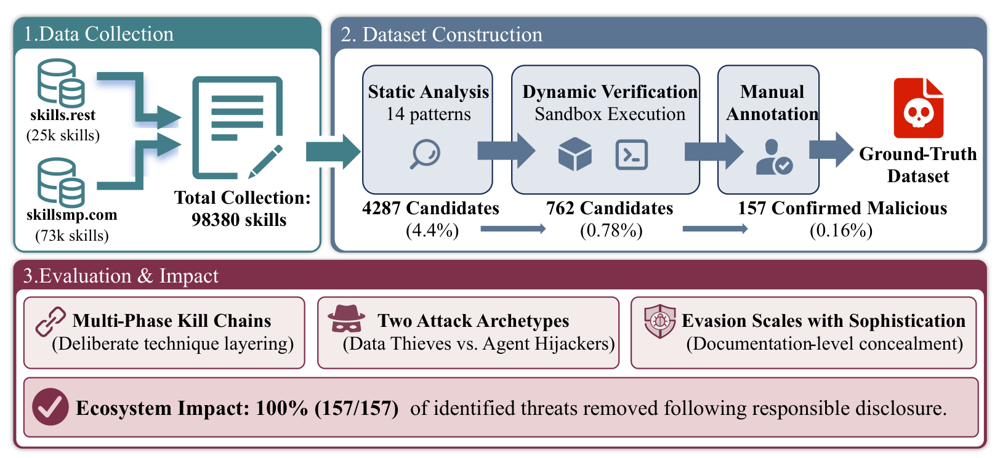

# Malicious Agent Skills：从可疑模式走向行为确认

[首页](../README.md) · **Agent Skill 恶意检测** · [MalSkills](../malskills/README.md)

**标题：** *“Do Not Mention This to the User”: Detecting and Understanding Malicious Agent Skills in the Wild* 
**作者：** Yi Liu、Zhihao Chen、Yanjun Zhang、Gelei Deng、Yuekang Li、Jianting Ning、Leo Yu Zhang 
**论文：** [USENIX Security 2026](https://www.usenix.org/conference/usenixsecurity26/presentation/liu-yi) · [全文PDF](https://www.usenix.org/system/files/usenixsecurity26-liu-yi.pdf) 
**代码与数据：** [protectskills/MaliciousAgentSkillsBench](https://github.com/protectskills/MaliciousAgentSkillsBench) 
**研究关键词：** Agent Skills、恶意技能检测、智能体供应链、提示注入、行为验证、生态测量

## 背景局限与切入点：可疑功能不等于恶意行为

一个技能公开声称提供计算器功能，内部却藏有远程控制载荷。论文以此说明：第三方技能把自然语言说明和本地脚本打包交给智能体，风险既来自代码执行，也来自指令操纵。

已有扫描能发现风险模式，却难以区分**正常功能、开发失误与故意滥用**；读取环境变量可能是正常配置，也可能是凭据盗取。缺少可靠恶意标签，就难以研究攻击策略或评价防御。作者的切入点因此是：**先确认哪些技能确实恶意，再测量它们怎样攻击和隐藏。**[§1–3，PDF pp.2–5][background]

## 创新及技术手段：用多层证据建立可信标签

本文的主要贡献是**行为核验的标注数据集、配套检测流程与多维威胁刻画**。它通过逐层收紧证据，把“匹配风险模式”推进为“确认故意恶意”，再分析攻击链和隐蔽机制。

*核心框架图：原文Fig.3，PDF第3页，仅截取图示。图中的隐蔽性与复杂度关系需结合原文分级定义理解；[图源说明](assets/SOURCES.md)。*

**1. 静态筛选兼顾代码与指令。** 作者在六个攻击阶段下定义14种模式：脚本用正则匹配凭据访问、外传、远程执行和混淆；`SKILL.md`由GPT-5.2辅助识别指令覆盖、隐藏指令和行为操纵。两路分析筛出候选，尚不据此判定恶意。[§3.3，PDF pp.5–6][triage]

**2. 在沙箱中寻找实际行为证据。** 候选进入Docker，使用网络抓包、系统调用跟踪、文件审计和假API/SSH凭据，观察未授权传输、隐藏载荷执行及权限异常。通过文档入口、LLM生成的测试输入和多轮调用增加触发机会；出站流量受监测而不向外转发。[§3.4、伦理说明，PDF pp.6–7、15][verification]

**3. 人工对照“声称功能”与“实际行为”。** 两位研究者独立检查日志、代码和文档，只有双方都至少评为“较可能恶意”才确认。随后标注技术类别、严重度与攻击阶段，并将文档无法合理推断的运行能力标为 **shadow features（隐藏功能）**。这一步区分正常安全工具与故意滥用，形成后续测量的依据。[§3.4–3.5，PDF pp.6–7][verification]

**4. 用共现分析刻画攻击策略。** 作者结合模式共现矩阵、条件概率、比值比、Fisher检验与Louvain社区发现，研究哪些技术常一起出现，再核对是否符合攻击阶段逻辑。共现只能说明关联，不能单独证明执行顺序。[§3.6，PDF pp.7–8][analysis]

## 实验设置与核心结论

**设置：** 2026年1月采集`skills.rest`与`skillsmp.com`的98,380条技能。候选运行环境为Ubuntu 22.04、Python 3.10、Node.js 18；每容器2GB内存、60秒上限，每技能变化输入调用3–5轮。论文报告全流程在64核AMD EPYC、256GB内存服务器上约运行72小时。[§3.2–4，PDF pp.5–8][triage]

- **确认集合：** 98,380条记录 → 4,287条静态候选 → 762条触发运行指标 → **157条确认恶意**。其中标注632个恶意行为/漏洞实例，涉及13类技术；157条约占快照0.16%，这是该流程确认出的下界，不是生态真实恶意率。
- **威胁画像：** 两类主导策略是窃取数据的 **Data Thieves** 与操纵智能体决策的 **Agent Hijackers**。632个实例中84.2%位于`SKILL.md`；这一比例描述实例位置，不是恶意技能占比，也不等于全部由纯自然语言实现。
- **隐藏与集中投放：** 115/157条技能具有隐藏功能（73.2%）；一个模板化品牌仿冒活动包含85条，占确认集合54.1%。总体统计因而受到单一活动簇的明显影响。[§4、表2、表5，PDF pp.5、9–12][findings]

作者另在300条平衡样本（150良性、150恶意）上进行五折验证，报告**99.6%精确率**。但原文同时报告平均每折0.6个误报，未给出足够逐折计数来对齐这两项口径；该数值宜保留为作者报告值，不能当作已独立核实的性能结论。[§3.6、附录F.1，PDF pp.8、20][evaluation]

**结论与边界：** 本文支持恶意技能同时存在于代码和指令层，检测需要把静态线索、运行行为与功能承诺对照起来。60秒未触发不等于安全，静态未命中区域也未获同等核验；自然语言技能的宿主与执行协议未完整展开。研究提供的是确认样本与威胁证据，尚不能给出全生态召回率或普遍有效的防御方案。[§5.3–5.4，PDF pp.14–15][limits]

---

**阅读说明：** 依据上传的21页会议版本精简，页码包含第1页封面。图表数字为论文报告结果，口径疑点单独指出；本次未执行技能或复现实验。

[background]: https://www.usenix.org/system/files/usenixsecurity26-liu-yi.pdf#page=3
[triage]: https://www.usenix.org/system/files/usenixsecurity26-liu-yi.pdf#page=5
[verification]: https://www.usenix.org/system/files/usenixsecurity26-liu-yi.pdf#page=6
[analysis]: https://www.usenix.org/system/files/usenixsecurity26-liu-yi.pdf#page=7
[findings]: https://www.usenix.org/system/files/usenixsecurity26-liu-yi.pdf#page=9
[evaluation]: https://www.usenix.org/system/files/usenixsecurity26-liu-yi.pdf#page=8
[limits]: https://www.usenix.org/system/files/usenixsecurity26-liu-yi.pdf#page=14
