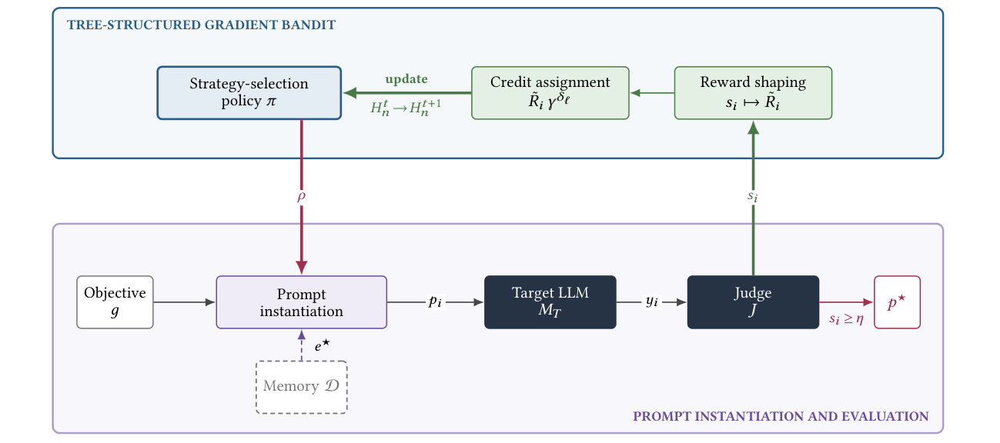
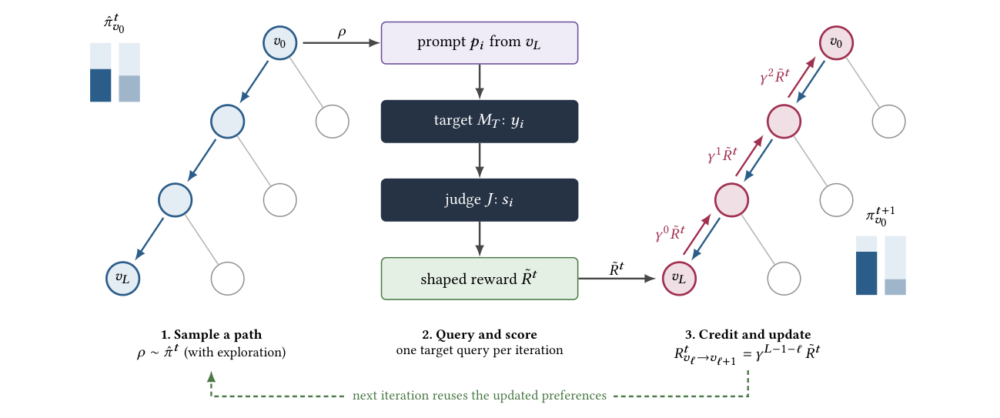

# TRAP：策略树如何学习，实验优势如何解释

[首页](../README.md) · [研究背景](../jailbreak-background/README.md) · [Causal Analyst](../causal-analyst/README.md) · **TRAP** · [Best-of-N](../best-of-n/README.md)

---

> **核心理解**：TRAP 把已有越狱策略组织成一棵固定的语义树，利用历史反馈学习跨任务共享的选择偏好，再由模板与检索模块构造具体提示。我的关注点是：共享偏好是否实现了对当前任务的策略匹配，以及实验收益能否归因于层次结构本身。

**文章目录**

- [1. 论文信息](#section-1)
- [2. 论文关注的问题](#section-2)
- [3. 整体流程与方法框架](#section-3)
- [4. 实验结果应当怎样读](#section-4)
- [5. 三项贡献与我的评价](#section-5)
- [6. 我的核心疑问：共享偏好是否等于按 goal 匹配](#section-6)
- [7. 读后记录与复核重点](#section-7)
- [参考资料](#section-8)

<a name="section-1"></a>

## 1. 论文信息

- **题目**：TRAP: Tree-Guided Reinforcement-Augmented Probing for Automated LLM Jailbreaking
- **作者**：Mohammad Reza Mirbagheri、Amir Mahdi Sadeghzadeh
- **单位**：Sharif University of Technology
- **阅读版本**：arXiv:2610.17313v1，2026-10-12，共 27 页
- **论文**：[arXiv 页面](https://arxiv.org/abs/2610.17313) · [v1 全文](https://arxiv.org/pdf/2610.17313v1)
- **代码**：[Rezamirbagheri110/TRAP](https://github.com/Rezamirbagheri110/TRAP)
- **关键词**：大模型安全、黑盒越狱、策略树、梯度赌博机、经验复用、越狱评测

本文中的页码均指 v1 的 PDF 页码。实验数值是原文报告结果，教学示例单独标注；本文没有开展真实攻击实验。

<a name="section-2"></a>

## 2. 论文关注的问题

已有方法可以搜索提示、修改候选文本或复用成功经验。TRAP 进一步关注：**如果把可复用策略组织成层次结构，能否让历史反馈帮助后续选择？**

它将两个环节分开：先在策略树上选择路径，再把所选策略转成当前任务的具体提示。理解这一区分，是读懂论文的起点。[TRAP 第3–5页](https://arxiv.org/pdf/2610.17313v1#page=3)

阅读时，我会区分四个概念：

| 概念 | 在本文中的含义 |
| --- | --- |
| **goal / 任务目标** | 当前需要测试的一项具体行为或请求 |
| **目标模型** | 接受提示、返回回答的被测 LLM |
| **策略路径** | 从树根到叶节点的一组层次选择 |
| **最终提示** | 所选策略与当前 goal 等内容结合后，实际提交给模型的文本 |

尤其要注意：“适合这个目标模型的策略”与“适合当前 goal 的策略”，是两个不同的问题。

<a name="section-3"></a>

## 3. 整体流程与方法框架

### 3.1 从固定策略空间到反馈更新

```text
离线整理已有策略，构建并固定语义树
                  ↓
根据共享偏好，逐层抽样一条策略路径
                  ↓
结合当前 goal 实例化模板，可选检索增强或辅助模型起草
                  ↓
获取目标模型回答，由固定评估器评分
                  ↓
奖励沿所选路径分配，更新节点偏好
                  ↓
后续尝试与其他 goal 继续复用已学偏好
```



*图 1. TRAP 闭环框架。来源：作者代码仓库，与论文 Fig. 1 对应。注意图中 goal 进入提示实例化模块，而不直接进入主策略选择器。*

### 3.2 策略树提供了什么

论文使用的完整配置包含 **11 个活跃策略族、164 个叶策略，最大深度为 4**。树在评测前离线整理并固定；运行中学习的是节点的选择偏好，不是不断新增树节点，也不是更新目标 LLM 的参数。[TRAP 第6–7页](https://arxiv.org/pdf/2610.17313v1#page=6)

四个语义层次是：

```text
策略族 → 策略子类 → 技巧组 → 叶策略
```

树中虽然包含 `multi_turn_manipulation` 标签，论文仍将这些策略作为单个提示执行，没有开展多轮对话实验。

我把它理解为一个带语义关系的策略目录：相近策略共享上层决策，反馈便可以影响同一分支中的后续选择。

[查看全部展开的策略树：11 个策略族、164 个叶节点](assets/trap-strategy-tree.png)

*展开图依据作者公开配置整理，便于对照目录层次；它不是论文实验中在线生长出来的搜索树。*

### 3.3 偏好值怎样变成一条路径

每个内部节点都为自己的子分支保存偏好值。选择时，先将偏好通过 Softmax 转成概率，再混入均匀探索：

```text
抽样概率 = (1 − ε) × Softmax(偏好值 / T) + ε / 子分支数
```

论文使用 `T = 1.0`、`ε = 0.1`。到达一个节点后，按概率抽取下一个分支，重复到叶节点；一条完整路径的抽样概率是沿途各次抽样概率的乘积。[TRAP 第9页](https://arxiv.org/pdf/2610.17313v1#page=9)

下面是一个**教学示例，数值不是论文实验结果**。假设根节点的三个分支偏好为 2、1、0：

| 分支 | 偏好值 | Softmax 概率 | 加入均匀探索后的抽样概率 |
| --- | ---: | ---: | ---: |
| A | 2 | 66.5% | 63.2% |
| B | 1 | 24.5% | 25.4% |
| C | 0 | 9.0% | 11.4% |

A 最容易被选中，B、C 也仍有机会。到下一层时，读取的是该节点自己的另一组偏好值。

因此，偏好值决定的是“更倾向走哪里”，路径由逐层抽样产生。它不等同于每次都走当前偏好最大的分支。

### 3.4 反馈更新的是哪些东西



*图 2. 一次学习迭代。来源：作者代码仓库，与论文 Fig. 4 对应。*

评分经过奖励塑形后，被分配到所选路径的各个决策；越靠近叶节点，获得的折扣越少。论文还使用经验回放，复用已记录的决策与反馈。[TRAP 第9–10页](https://arxiv.org/pdf/2610.17313v1#page=9)

这里的“学习”主要表现为**节点偏好和抽样概率持续变化**。这些偏好在一个目标模型的实验运行中跨 goal 保留，而每个 goal 的最佳评分、已尝试策略等会重新初始化。[TRAP 第6页](https://arxiv.org/pdf/2610.17313v1#page=6)

### 3.5 当前 goal 在哪里发挥作用

| 环节 | 是否直接使用当前 goal |
| --- | --- |
| 主赌博机的路径选择 | 不直接读取 goal 文本 |
| 模板实例化 | 使用 goal 构造具体提示 |
| 检索历史示例 | 结合 goal 与所选叶策略查询经验 |
| 辅助模型起草或改写 | 使用当前任务内容 |
| 评分与后续更新 | 根据本次任务及回答产生反馈 |

这个划分说明：**整个系统会使用 goal，但主路径选择器并没有直接学习“看到哪类 goal，就选择哪条路径”的映射。** 检索与提示构造带来的任务适配能力，需要与主策略政策区分。[TRAP 第4–5、10–11页](https://arxiv.org/pdf/2610.17313v1#page=10)

<a name="section-4"></a>

## 4. 实验结果应当怎样读

### 4.1 先明确实验口径

| 项目 | 原文设置 |
| --- | --- |
| 攻击条件 | 单轮、纯文本、黑盒访问 |
| 数据 | 主比较使用 AdvBench 的 520 个目标 |
| TRAP 预算 | 每个 goal 最多提交 10 次目标模型查询 |
| 预算范围 | 不包含辅助模型、评估器及嵌入等调用 |
| 成功判据 | 主混合评估器最终评分不低于 7/10 |
| 跨目标状态 | 按固定顺序处理目标，保留共享偏好及相应检索状态 |

这属于有经验积累的顺序评测，不能直接当作每个 goal 都从零开始、彼此独立的测试。[TRAP 第6、14–15页](https://arxiv.org/pdf/2610.17313v1#page=14)

### 4.2 主表结果：模型名称与系统角色要分清

| 被测目标模型 | TRAP 报告的 ASR |
| --- | ---: |
| GPT-OSS-120B | 0.0% |
| Mistral-7B-Instruct | 94.0% |
| LLaMA-4-Scout | 76.2% |
| Qwen3-235B-A22B | 84.4% |
| DeepSeek-V3.2 | 97.9% |
| GPT-4o-mini | 45.6% |
| Gemini-2.5-Flash | 78.1% |

来源：原文表 5。辅助构造提示的模型固定为 **Qwen2.5-7B-Instruct**，主评估器的 LLM 组件使用 **GPT-4o-mini**。后者同时是一个被测目标，但两种角色需要区分。[TRAP 第14–16页](https://arxiv.org/pdf/2610.17313v1#page=14)

论文在同一主评估器、各方法既定配置下，报告 TRAP 在六个模型上取得最高观察 ASR；GPT-OSS-120B 上各方法均未成功。**主表没有统一各方法的查询预算**，所以这些差距不能直接解释为层次结构本身的独立增益。[TRAP 第16页](https://arxiv.org/pdf/2610.17313v1#page=16)

### 4.3 关键消融：哪些比较能回答什么问题

| 对照 | 能检验什么 | 阅读边界 |
| --- | --- | --- |
| 完整树 + 静态检索，对比完整树 + 无检索 | 在相同树下，检索是否有帮助 | 收益随目标模型变化 |
| 剪枝层次树，对比扁平选择 | 在同样 36 个叶策略和静态检索下，层次结构的作用 | 仅使用 52 个目标的子集 |
| 静态检索版，对比在线检索完整版 | 在线增加记忆是否带来额外收益 | 在线版没有稳定超过静态版 |

其中，层次与扁平的对照最接近核心结构主张。52 个目标中，多成功一个目标约对应 **1.92 个百分点**；表 6 中一些差距接近这个量级，也存在下降。因此，我更关注这些差异能否跨种子、目标顺序和更大样本保持，而不只看单次表格排名。[TRAP 第17页](https://arxiv.org/pdf/2610.17313v1#page=17)

### 4.4 评估器是证据链的一部分

作者开展了九种自动判定流程和盲评人工多数标签的分析。结果显示，不同裁判会改变观察到的方法排名。主评估器还会检查提示形式；反转式提示可能受到压分，即使回答本身流畅且包含实质内容。[TRAP 第18–21、24–25页](https://arxiv.org/pdf/2610.17313v1#page=18)

我的理解是：**“使用同一个裁判”有助于统一判定口径，但不自动意味着对所有方法都公平。** 如果规则与某类方法的表达形式相关，就需要进一步核验这种规则是否影响结论。

另一个需要区分的数字是：表 8 的“被判为越狱的响应比例”是对固定回答集合重新打分，不能与预算内至少成功一次的任务级 ASR 混为一谈。[TRAP 第20页](https://arxiv.org/pdf/2610.17313v1#page=20)

<a name="section-5"></a>

## 5. 三项贡献与我的评价

| 贡献 | 论文工作 | 我的评价 |
| --- | --- | --- |
| 固定语义策略空间 | 将已有技巧组织为可复用的策略树 | 价值在结构化组织；不能仅由叶节点数量判断新颖性 |
| 层次选择与经验复用 | 沿路径分配反馈，跨 goal 保留偏好，并连接检索构造 | 有系统与方法设计价值；基础梯度赌博机已有先例 |
| 跨模型评测与裁判分析 | 比较基线、设置消融，并核验裁判依赖 | 有分析价值；同时暴露预算、归因和测量上的边界 |

我的评价是：**TRAP 更接近已有策略的结构化选择与经验复用研究**。它没有展示明确的新基本越狱机理，但这并不等于没有研究贡献。需要检验的是，层次组织、反馈分配和复用机制是否解决了明确问题，并产生可独立验证的收益。[TRAP 第3–11页](https://arxiv.org/pdf/2610.17313v1#page=3)

<a name="section-6"></a>

## 6. 我的核心疑问：共享偏好是否等于按 goal 匹配

### 6.1 抽到不同路径，不等于理解了不同 goal

主政策保存跨 goal 共享的偏好。**在相同偏好状态和采样条件下，改变 goal 文本不会自动改变主选择器的路径概率。**

两种选择方式可以分别记为：

| 方式 | 含义 |
| --- | --- |
| `P_t(路径)` | 按当前共享偏好抽样 |
| `P_t(路径 \| goal)` | 根据当前 goal 的内容改变选择分布 |

TRAP 的主政策对应第一种。随机探索、反馈更新和防重复措施可以带来路径变化；对当前 goal 的具体适配则还发生在后续构造阶段。**路径多样性与任务匹配能力应分别验证。**[TRAP 第4–5、9、13页](https://arxiv.org/pdf/2610.17313v1#page=4)

### 6.2 偏向一条路径，不说明 goal 与策略没有联系

下面仍然是**教学示例，不是论文实测结果**；只讨论按成功率比较的简化情形，不模拟 TRAP 的完整塑形奖励。

| goal 类型 | 出现比例 | 策略 S1 成功率 | 策略 S2 成功率 |
| --- | ---: | ---: | ---: |
| A 类 | 80% | 90% | 10% |
| B 类 | 20% | 10% | 90% |

这里，A 适合 S1，B 适合 S2，匹配关系很明显。但不区分 goal 的选择器看到的是平均表现：

- S1：`80% × 90% + 20% × 10% = 74%`。
- S2：`80% × 10% + 20% × 90% = 26%`。

它可能因此越来越偏向 S1。这个现象说明，**即使 goal 与策略有很强联系，共享偏好也可能因平均收益而集中选择**。仅凭选择集中，无法判断某条路径普遍适用，还是多数任务的收益掩盖了少数任务的需求。

### 6.3 最大概率路径，不等于多数 goal 的最佳路径

固定时刻的树是有限的，因此至少存在一条概率最大的完整路径，也可能并列。但这只是有限分布的性质，不能推出：

- 它的选择概率超过一半；
- 它会长期保持最大概率；
- 它适用于大多数 goal；
- 它对每个 goal 都最有效。

因此，我不会把论文的关键产出概括为“找到一条适用于大多数 goal 的路径”。更准确的是：**建立可复用的策略空间，并学习哪些路径值得优先尝试。**

### 6.4 后续值得核验的开放问题

- 不同 goal 是否确实存在稳定的策略适配差异？
- 共享偏好能否兼顾频率较低的任务类型？
- 以 goal 为条件的选择，能否在未见任务上保持收益？
- 收益来自层次选择，还是检索内容、模板库存和辅助生成？

这些是从阅读中提出的问题，尚不能据此认定一个新的研究贡献已经成立。

<a name="section-7"></a>

## 7. 读后记录与复核重点

对这篇论文，我最需要保留的区分是：

1. **策略树与提示树**：TRAP 在固定策略层次上学习选择，不能与为单个 goal 扩展提示候选的搜索树混同。
2. **探索与匹配**：保留随机探索，不代表选择器已经理解当前任务。
3. **总体成绩与独立贡献**：完整系统表现突出，需要进一步区分层次结构、检索和其他组件的作用。
4. **高分与成功定义**：评分既影响学习，也影响 ASR；结论必须结合裁判规则解释。

如果继续核对公开实现，还需要检查“所选叶策略 → 实际模板 → 最终提示”的对应关系。作者说明原始检索记忆未公开，所以现有材料能够帮助理解和独立实现方法，但不能据此声称已经完整复现论文表格。[TRAP 第21页](https://arxiv.org/pdf/2610.17313v1#page=21)

这与[第一篇 Causal Analyst 笔记](../causal-analyst/README.md)有一个共同关注点：**系统效果、解释机制与具体组件的独立贡献，需要分别寻找证据。**

<a name="section-8"></a>

## 参考资料

- [TRAP：arXiv:2610.17313v1](https://arxiv.org/abs/2610.17313v1)
- [TRAP v1 论文全文](https://arxiv.org/pdf/2610.17313v1)
- [作者代码仓库：Rezamirbagheri110/TRAP](https://github.com/Rezamirbagheri110/TRAP)
- [AdvBench 原始数据](https://github.com/llm-attacks/llm-attacks/blob/main/data/advbench/harmful_behaviors.csv)
- [本文配图与展开图的来源说明](assets/SOURCES.md)

*本文为第二篇论文阅读笔记，依据公开材料记录方法理解与个人评价。整理日期：2026-10-19。*
